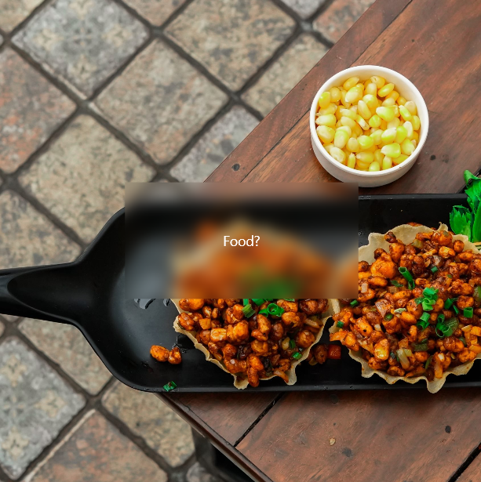
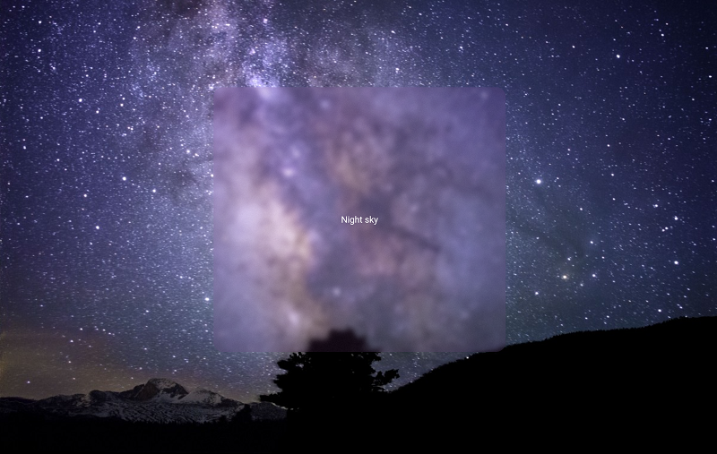

[](https://pub.dev/packages/glass)
[](https://opensource.org/licenses/BSD-3-Clause)

# Glass
Easily convert any Widget into a glass / frosted glass version of itself, following the glassmorphism / glassmorphic  design trend.




## Installation

### 1. Add it

```bash
flutter pub add glass
```

Requires Flutter 3.27 or newer (Dart 3.6+). Older Flutter versions automatically resolve to glass 2.0.0.

### 2. Import it

Now in your Flutter code, you can use:

```Dart
import 'package:glass/glass.dart';
```

## Usage

Simply call .asGlass() <with parameters if needed> on the widget you want to convert to glass.

For example: 

```Dart
Container(
    child: someChild,
).asGlass()
```

Glass blurs what is *behind* the widget, so it only shows up when there is content underneath
(for example inside a `Stack` or over a background image).

### Parameters

| Parameter | Default | Description |
|---|---|---|
| `enabled` | `true` | Enable or disable all effects. |
| `blurX` / `blurY` | `10.0` | Blur amount along each axis. |
| `tintColor` | `Colors.white` | Tint of the glass. Use `Colors.transparent` for no tint. |
| `frosted` | `true` | Adds a noise texture for a frosted look. |
| `clipBorderRadius` | `BorderRadius.zero` | Rounded corners. Ignored if `clipper` is set. |
| `clipBehavior` | `Clip.antiAlias` | How the glass is clipped. |
| `clipBehaviour` | `null` | **Deprecated** misspelling of `clipBehavior`, removed in 3.0.0. |
| `tileMode` | `TileMode.clamp` | How the blur samples at the edges. |
| `clipper` | `null` | Custom `CustomClipper<RRect>`. |

A full example can be found in the example directory.

## Using glass with scrolling

Glass blurs what is behind it, so a glass panel that should stay in place while content scrolls
should **wrap** the scroll view rather than sit inside it:

```Dart
SingleChildScrollView(
  child: Column(children: [...]),
).asGlass()
```

If the glass is *inside* the scroll view, Android's Material 3 stretch overscroll renders the
scrollable in its own layer, and the blur disappears while you drag past the top or bottom edge.
If you do need glass items inside a scrollable (for example glass cards in a list), turn the stretch
off for that scroll view:

```Dart
ScrollConfiguration(
  behavior: ScrollConfiguration.of(context).copyWith(overscroll: false),
  child: ListView(children: [...]),
)
```

## About me

Visit my LinkedIn at https://www.linkedin.com/in/zaca
