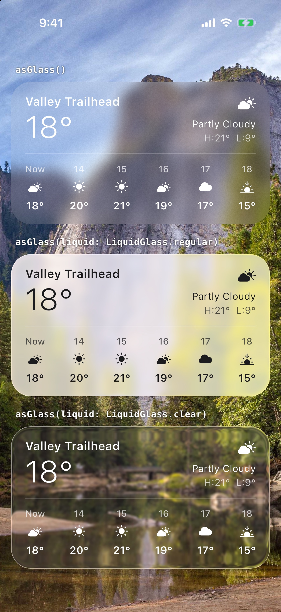
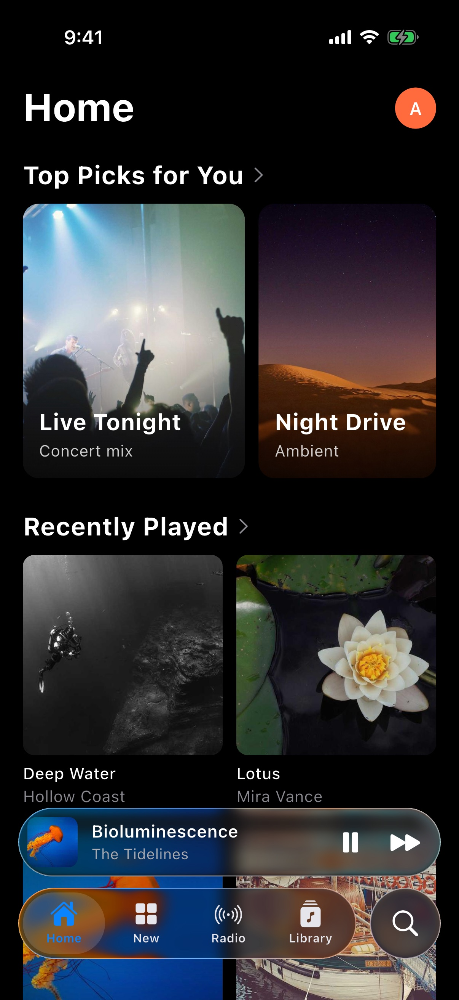
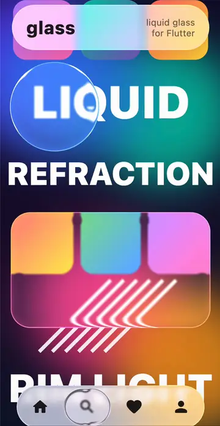

[](https://pub.dev/packages/glass)
[](https://opensource.org/licenses/BSD-3-Clause)

# Glass
Easily convert any Widget into a glass / frosted glass version of itself, following the glassmorphism / glassmorphic design trend, or into Apple-style liquid glass (experimental).

<p>
  
  
  
</p>

## Installation

### 1. Add it

```bash
flutter pub add glass
```

Requires Flutter 3.29 or newer (Dart 3.7+). Older Flutter versions automatically resolve to an earlier glass
release (2.1.x on Flutter 3.27, 2.0.0 before that).

### 2. Import it

Now in your Flutter code, you can use:

```Dart
import 'package:glass/glass.dart';
```

## Usage

Simply call .asGlass() <with parameters if needed> on the widget you want to convert to glass.

For example: 

```Dart
Container(
    child: someChild,
).asGlass()
```

Glass blurs what is *behind* the widget, so it only shows up when there is content underneath
(for example inside a `Stack` or over a background image).

### Parameters

| Parameter | Default | Description |
|---|---|---|
| `enabled` | `true` | Enable or disable all effects. |
| `blurX` / `blurY` | `10.0` | Blur amount along each axis. |
| `tintColor` | `Colors.white` | Tint of the glass. Use `Colors.transparent` for no tint. |
| `frosted` | `true` | Adds a noise texture for a frosted look. |
| `clipBorderRadius` | `BorderRadius.zero` | Rounded corners. Ignored if `clipper` is set. |
| `clipBehavior` | `Clip.antiAlias` | How the glass is clipped. |
| `tileMode` | `TileMode.clamp` | How the blur samples at the edges. |
| `clipper` | `null` | Custom `CustomClipper<RRect>`. |
| `liquid` | `null` | Experimental liquid glass settings, see below. |
| `grouped` | `false` | Share the backdrop of the nearest `BackdropGroup`, see [many glass widgets](#many-glass-widgets-on-screen). |

A full example can be found in the example directory.

## Liquid glass (experimental)

Pass `liquid:` to get a glass that bends the backdrop at its edges and draws a light rim, modelled
on Apple's liquid glass:

```Dart
Container(child: someChild).asGlass(
  clipBorderRadius: BorderRadius.circular(32),
  liquid: LiquidGlass.clear, // or LiquidGlass.regular
)
```

- `LiquidGlass.clear` is highly transparent, for use over rich media (like Apple's `Glass.clear`).
- `LiquidGlass.regular` is a light, mostly opaque frost with a soft shadow, for when content on the
  glass must stay legible (like Apple's `Glass.regular`).
- For your own look, create `LiquidGlass(...)` with `blur`, `tintColor`, `tintStrength`,
  `saturation`, `refraction`, `edgeWidth`, `lift`, `midtoneLift`, `highlight` and `shadow`, or
  start from a preset with `LiquidGlass.clear.copyWith(...)`. Explicit `blurX`, `blurY`,
  `tintColor` and `frosted` arguments to `asGlass` override the preset.

Things to know:

- The refraction and rim need a fragment shader backdrop filter, which Flutter supports only on
  **Impeller** (the default on iOS, Android and macOS). On web and on the Skia renderer, `liquid:`
  falls back to plain blur and tint, so it is safe to use everywhere.
- The refraction and rim follow the clip shape: `clipBorderRadius` (each corner can have its own,
  also elliptical, radius) or a custom `clipper`.
- Corners are circular or elliptical arcs, not Apple's continuous "squircle" corners. Overlapping
  glass shapes don't merge.
- Like plain glass, each liquid glass is a backdrop filter. For many on screen at once, see
  [many glass widgets](#many-glass-widgets-on-screen).
- The shader loads the first time a liquid glass is built, and until then that glass shows the plain
  blur for a frame or two. To show liquid glass from the very first frame, load it ahead of time:

  ```dart
  void main() async {
    WidgetsFlutterBinding.ensureInitialized();
    await LiquidGlass.precache();
    runApp(const MyApp());
  }
  ```

## Using glass with scrolling

Glass blurs what is behind it, so a glass panel that should stay in place while content scrolls
should **wrap** the scroll view rather than sit inside it:

```Dart
SingleChildScrollView(
  child: Column(children: [...]),
).asGlass()
```

If the glass is *inside* the scroll view, Android's Material 3 stretch overscroll renders the
scrollable in its own layer, and the blur disappears while you drag past the top or bottom edge.
If you do need glass items inside a scrollable (for example glass cards in a list), turn the stretch
off for that scroll view:

```Dart
ScrollConfiguration(
  behavior: ScrollConfiguration.of(context).copyWith(overscroll: false),
  child: ListView(children: [...]),
)
```

## Many glass widgets on screen

Each glass reads and blurs the screen behind it, so many of them (for example glass cards in a
list) can make scrolling stutter, especially liquid glass. Put a `BackdropGroup` above them and pass
`grouped: true`, and they share one copy of the backdrop:

```Dart
BackdropGroup(
  child: ListView.builder(
    itemBuilder: (context, i) => ListTile(title: Text('Item $i')).asGlass(
      clipBorderRadius: BorderRadius.circular(16),
      liquid: LiquidGlass.clear,
      grouped: true,
    ),
  ),
)
```

On an Android phone at 90 Hz, a list of liquid glass cards took about 14 ms per frame, which drops
frames, and about 4.5 ms grouped. Grouped glass blurs the backdrop as it was before the group's first
glass was drawn, so it doesn't show other glass that it overlaps. Leave `grouped` off for glass that
sits on top of other glass, such as a tab bar over a list of grouped cards.

## About me

Visit my LinkedIn at https://www.linkedin.com/in/zaca
